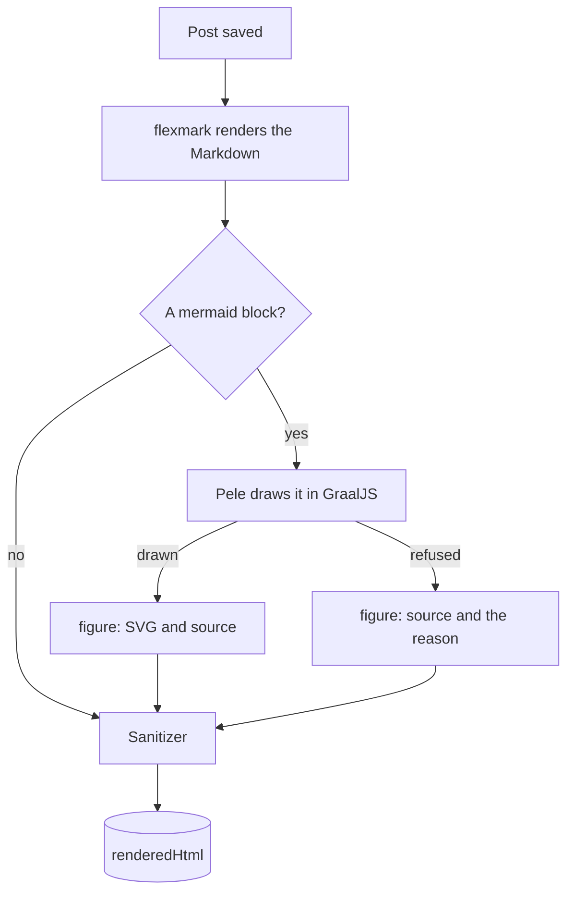
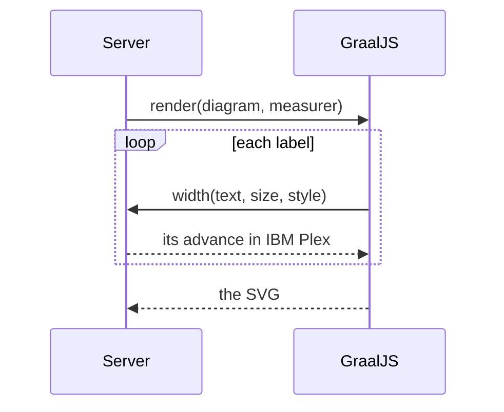

# How Diagrams Are Drawn

A ```` ```mermaid ```` block in a post becomes an SVG on the server, when the post is saved (#252). This page explains why it happens there, and how. To write one, see [Draw Diagrams in Posts](../how-to/blog/draw-diagrams-in-posts.md); for the HTML it becomes, [Diagram HTML](../reference/diagram-html.md).

## Why on the Server

Every front end shows a post's stored `renderedHtml`. A diagram drawn into it reaches every site, the feeds and anything else that reads the API, with no script in the reader's browser.

Mermaid.js itself can't do this: it needs a real browser DOM to measure text, so drawing it on a server has meant running a headless browser. [Pele](https://pele.run), Obsidian's Mermaid renderer, needs no DOM and has no dependencies. Its `render()` takes the diagram's text and returns an SVG string.

## The Path a Block Takes



1. flexmark renders the Markdown as it always has. A Mermaid block is `<pre><code class="language-mermaid">`.
2. Each block, up to fifty a post, goes to Pele. Pele runs in [GraalJS](https://www.graalvm.org/javascript/), a JavaScript engine that runs inside the JVM as an ordinary library.
3. A drawn diagram becomes a `figure.mermaid` with the SVG and its source. One Pele refuses keeps its source, with the reason.
4. The sanitizer cleans the page as before. It rebuilds each figure on its own, with an allowlist that only admits what Pele draws, so the page's own allowlist stays as narrow as it was.

The startup pass that sanitizes stored HTML again rebuilds figures the same way, and the result is the same each time, so it leaves stored diagrams alone.

## GraalJS without GraalVM

GraalJS is a set of Maven artifacts (`org.graalvm.polyglot:polyglot` and `js-community`). The server runs it on the same Temurin JDK as everything else.

On a JDK without the Graal compiler, GraalJS interprets JavaScript rather than compiling it. On an arm64 Mac with Temurin 25, the first diagram after a start takes about a second, which is starting the engine and loading Pele. After that, each diagram takes about 4 ms, with a fresh context each time. A post is drawn once, when it's saved, so that's plenty.

Compiled mode was tried. It needs the Graal compiler's jars on the JVM's module path, JVMCI turned on, and a JDK whose JVMCI matches that compiler build for build: the newest Graal refused Temurin 25.0.4.1, and the matching one only ran after overriding a configuration check. Warm, it was about seven times faster, but it took about a thousand diagrams to warm up, and before that it was slower. For drawing at save time, interpreted wins.

## Each Diagram Is Isolated

The server keeps one GraalJS engine, started by the first diagram, not by the server. Each diagram gets a fresh context on it:

- It has no I/O, and nothing of the server except the text measurer's `width()`.
- Nothing is kept from one diagram to the next, so one author's diagram can't affect another's.
- Pele has no time limit of its own, so a watchdog cancels a diagram that runs past `BLOG_MERMAID_TIMEOUT` (five seconds).
- Pele is called with links and images turned off, so a diagram can't link anywhere or load anything.

## Measuring Labels in a Real Font

Pele sizes each node's box to fit its label, so it has to know how wide the label is. In a browser, it measures with a canvas. Elsewhere, it estimates from a table of Arial's widths for the ASCII characters, with no kerning, and a flat width for every other character.

The server measures instead. Pele takes a measurer, an object with one method, `width(text, size, style)`. The server passes it a Kotlin object whose `width()` uses Java 2D's `TextLayout`, in IBM Plex Sans and IBM Plex Mono, which it bundles:



The SVG then names the fonts it was measured in, and the front ends serve them for diagrams, so a label fits its box on every site.

Java 2D needs three things done the way a browser does them:

- **Real faces.** A font loaded from a file has one face. Asking it for bold makes up bold, metrics included. So each family is four files: regular, bold, italic and bold italic.
- **Fallback, character by character.** A loaded font doesn't fall back to another for characters it lacks, as a CSS font stack does. The measurer takes each character from Plex if Plex has it, and otherwise from Java's logical `SansSerif` font, which does fall back. A character no font on the server has (CJK, in the server's image, which has only DejaVu besides Plex) gets Pele's own estimate. A missing glyph's box would be too narrow.
- **Kerning and fractions.** Java 2D has kerning off by default. Browsers have it on and measure in fractions of a pixel. The measurer turns on kerning, ligatures and fractional metrics.

How much it changes, as one-node flowcharts measured both ways (box widths in pixels, padding included, at 16 px):

| Label | Pele's table | IBM Plex |
|---|---|---|
| `Publish` | 105 | 106 |
| `Reviewed and approved` | 225 | 224 |
| `WAVE AVAILABLE` | 190 | 181 |
| `minimum illuminati` | 184 | 191 |
| `Café déjà vu, naïve façade` | 250 | 238 |
| `Ünïcödé Größe` | 165 | 160 |

The widths are the same on a Mac and in the server's image, because the fonts are bundled rather than found on the system.
