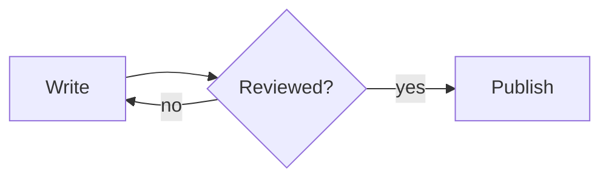

# Draw Diagrams in Posts

A post or comment can hold a [Mermaid](https://mermaid.js.org/intro/) diagram. The server draws it as a picture when the post is saved, so readers see the diagram on every site, with no script running in their browser.

## Draw a Diagram

Put the diagram in a fenced code block, with `mermaid` after the opening fence:

````markdown

````

Every diagram type Mermaid has is drawn: flowcharts, sequence, class, state and entity-relationship diagrams, Gantt charts, pie charts, mind maps, timelines and the rest. The server uses [Pele](https://pele.run), which supports every diagram type in Mermaid 12.1.

Readers see the diagram, and under it a closed **Diagram source** section with the text you wrote.

## Give the Diagram a Title and a Description

Screen readers announce a diagram by its kind, such as "Diagram (flowchart)", unless you name it. Add `accTitle` and `accDescr` after the first line:

````markdown

````

## When a Diagram Isn't Drawn

If the diagram has a mistake, the post still saves. The block stays as code, with a line under it that says what's wrong:

```text
This diagram wasn't drawn: Parse error on line 3: Expecting 'NODE_STRING', got 'EOF'
```

Correct the diagram and save the post again.

A diagram also isn't drawn when:

- its source is longer than 20,000 characters;
- it takes more than five seconds to draw;
- it's after the fiftieth diagram in one post or comment. The fifty-first and later stay as code.

## What Diagrams Can't Do

- **Links and images are left out.** A `click` line, or an image in a node, draws nothing, so a diagram can't send readers anywhere or load anything.
- **Diagrams use their own font.** Labels are in IBM Plex Sans, whatever the site's text uses, because each box is sized to its label in that font when the post is saved.
- **Colours follow the site's theme.** A diagram takes its colours from the site, light or dark. Colours you set with `style` or `classDef` are kept, so choose ones that read in both themes, and don't use colour as the only way to tell things apart: label them too.

## For the Operator

Diagrams are on by default. To turn them off, set `BLOG_MERMAID_ENABLED=false`. Posts saved while it's off keep their Mermaid blocks as code. `BLOG_MERMAID_TIMEOUT` changes the five-second limit. See [Environment Variables](../../reference/environment-variables.md).

## See Also

- [How Diagrams Are Drawn](../../explanation/diagrams.md): why the server draws them, and how.

- [Diagram HTML](../../reference/diagram-html.md): the HTML a diagram becomes, for front-end authors.
